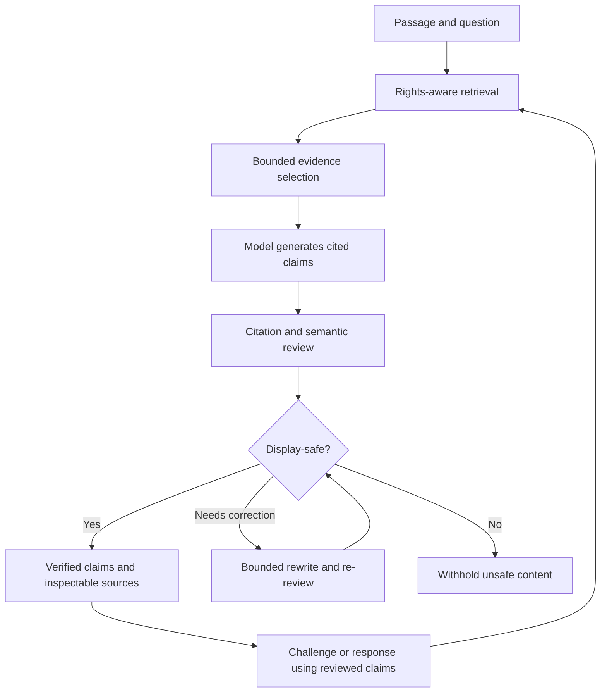

# CanonRoot

**AI-assisted Bible study designed around inspectable evidence, meaningful challenge, and accountable answers.**

CanonRoot is an independent product project exploring a question that matters across AI applications: **How can a system help people reason through complex material without asking them to trust an opaque model response?**

The first working product slice centers on **Romans 9:6–24**. Readers can examine a passage, ask a question, inspect supporting sources, challenge an interpretation, and review a response to that challenge.

> **Project status:** Active development and evaluation. This repository is a public **architecture and product showcase**, not the application source code, a downloadable product, or a claim of production readiness.

## The product experience

| Journey | What the reader can do | What the system is designed to protect |
| --- | --- | --- |
| **Read → Ask → Sources** | Explore a biblical passage, ask a question, and inspect cited evidence | Separate primary sources from generated explanation |
| **Answer → Challenge → Respond → Compare** | Examine a serious counterinterpretation and a response | Preserve the exact reviewed claims passed between stages |
| **Source → Primary text → Scripture** | Follow a citation to its underlying material | Make important assertions independently inspectable |

### Why this is different from a general-purpose chatbot

CanonRoot is designed to gather an eligible evidence set *before* generation. The model's answer is broken into claims, associated with citations, and checked against the cited material. A conservative display boundary withholds claims that do not meet the verification criteria. The same process applies to the challenge and response stages.

The project also distinguishes **what a passage says**, **what a particular interpreter concludes**, **what historical sources teach**, and **what AI has synthesized**. Scripture remains the theological authority; AI is an aid for exploring the material, not a replacement for it.

## Conceptual architecture

*Simplified conceptual diagram, not the source code or a complete deployment design. Correction is bounded, not an unlimited retry loop.*

## What this project demonstrates

- **AI product design:** A complete reader journey built around the limitations of generated text.
- **LLM orchestration:** Multiple reasoning stages with explicit inputs and outputs.
- **Evidence-grounded generation:** Retrieval and claim-level references before an answer reaches the UI.
- **Adversarial evaluation:** Deliberate treatment of serious alternative interpretations.
- **Verification and safety:** Deterministic checks, semantic review, and fail-closed display decisions.
- **End-to-end engineering:** A mobile application, server API, validation components, and repeatable tests.

## Explore the showcase

- [Product principles](docs/PRODUCT_PRINCIPLES.md) — user promise, source hierarchy, and fair challenge.
- [System architecture](docs/ARCHITECTURE.md) — major components, data movement, and trust boundaries.
- [Verification and testing](docs/VERIFICATION.md) — how the project approaches citation support and adversarial evaluation.
- [Illustrative debate-loop walkthrough](examples/ILLUSTRATIVE_DEBATE_LOOP.md) — a made-for-documentation example, not a captured model transcript.
- [Illustrative display data](examples/illustrative_display.json) — explicitly fictional API-like data for understanding the concept, **not** the real API contract.

## Technology overview

The private implementation uses a **TypeScript monorepo**, with an **Expo/React Native** mobile client, server-side API, retrieval and citation services, model adapters, and semantic verification. The architecture separates provider-specific model calls from domain-level evidence and validation rules.

## Public/private boundary

This repository intentionally contains **no application source code**, model prompts, private source corpora, credentials, deployment settings, internal endpoints, authentication tokens, proprietary configurations, or unreviewed transcripts. Examples are authored from scratch and labeled illustrative. Screenshots and recorded demonstrations may be added after a separate disclosure review.

## About the builder

**Jeff English** — Principal Product Manager and hands-on AI product builder, with a background in digital banking, complex product delivery, and turning concepts into working software.

[GitHub profile](https://github.com/jeff-english)

---

**Scope note:** This project is independent of my employer. The showcase describes architectural ideas and development work, not a public commercial release. This repository does not grant a license to any private application code or third-party source material.
