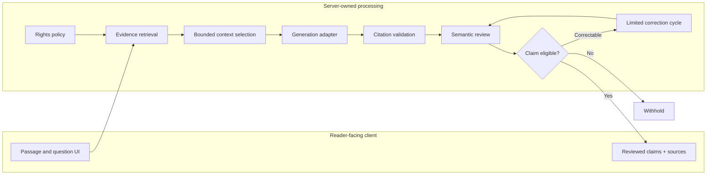
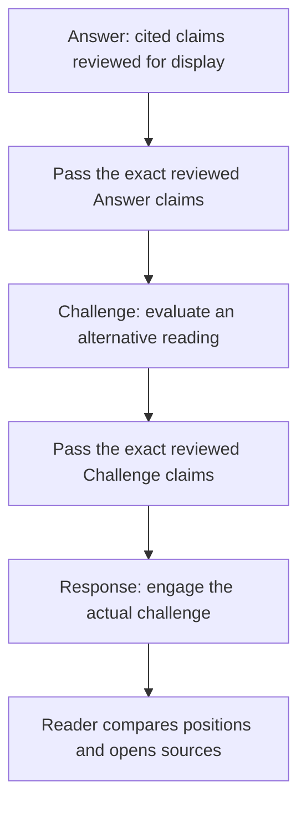

# CanonRoot — conceptual architecture

This public document explains the system **at the component level**. It is intentionally not a deployment runbook, source-code map, secret inventory, or specification of private interfaces.

## Major responsibilities

| Layer | Responsibility |
| --- | --- |
| **Reader experience** | Passage reading, questions, challenge/response navigation, and citation inspection in an Expo/React Native mobile client |
| **API and orchestration** | Route authorized interactions through controlled answer, challenge, and response workflows |
| **Source and rights policy** | Track which evidence may be consulted, displayed, or used as model input |
| **Retrieval** | Select relevant passages and permitted supporting materials before generation |
| **Model adapters** | Provide an interchangeable interface for text generation and model-assisted review |
| **Claim validation** | Check references and assess whether cited evidence supports individual claims |
| **Display boundary** | Surface only reviewed, eligible claims; withhold unverifiable output |

## Main data flow

*The diagram is illustrative. It omits authentication, rate limiting, persistence, operational controls, and implementation-specific branching.*

## The debate loop

The key architectural constraint is that a downstream stage should use the **prior stage's reviewed claims**, rather than trust a fresh summary or unreviewed generated text. Each new stage performs its own evidence retrieval and validation.

## Trust boundaries

- **Evidence boundary:** Only content that passes source-rights policy may enter a generation context.
- **Model boundary:** Model text is a proposal for review, not automatically displayable content.
- **Citation boundary:** Unsupported or unknown references are not accepted as proof.
- **Review boundary:** Source relevance and claim support are not identical; a semantic review step checks for overstatement and attribution errors.
- **Client boundary:** The reader-facing experience uses eligible, reviewed claims rather than raw model-generation payloads.

## What is intentionally not published

Prompt templates, full source datasets, internal request/response contracts, production configurations, token or session handling details, infrastructure identifiers, access controls, secrets, and proprietary implementation code remain in the private repository.

## Limits of the approach

Citation checking does not settle contested theology. A review model may make mistakes, and automatic correction is not a guarantee of accuracy. CanonRoot's architecture aims to make those limitations easier to detect and contain, not to claim that a model can prove an interpretation is correct.
